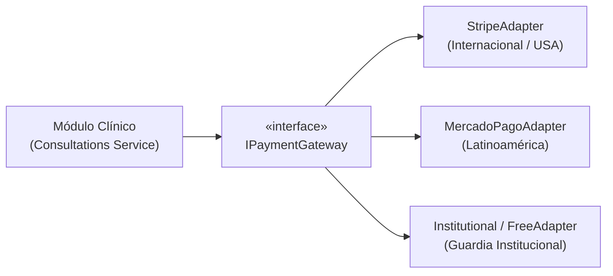

# 🏛️ 01_WHITE_LABEL_PAYMENTS_ARCHITECTURE — Arquitectura de Pagos Marca Blanca (Plan A)

> **Documento Oficial del Núcleo de Pagos:**  
> Especifica la arquitectura de monetización modular para VetConnect / Huellicam como software **Marca Blanca (White-Label)** exportable.

---

## 1. Filosofía de Marca Blanca y Desacoplamiento

El propósito central de un software marca blanca es que el código base no dependa de ningún proveedor financiero, bancario o impositivo particular. Cada cliente o entidad que adquiere una licencia de Huellicam / VetConnect (hospitales veterinarios, redes de clínicas, aseguradoras o startups en cualquier país) debe poder configurar su propio modelo de cobro y su pasarela preferida.

### Principio de Inversión de Dependencias (DIP)
El módulo de consultas (`backend/src/modules/consultations`) **nunca interactúa directamente con APIs de pago concretas**. Toda operación financiera se delega a la interfaz abstracta `IPaymentGateway`:



---

## 2. Modelo de Cobro Estándar en Telemedicina Veterinaria

### 2.1 Cobro por Consulta (*Fee-per-Consultation*)
* **Tarifa Base:** Cada consulta telemédica tiene un costo predeterminado. Puede ser fijado por la organización o configurado por el veterinario respetando los aranceles mínimos éticos del colegio veterinario de su jurisdicción.
* **Comisión de Plataforma (*Platform Take-Rate*):** El software permite parametrizar un porcentaje de intermediación (típicamente entre 15% y 25%).
* **Liquidación Neta:** El saldo neto (arancel menos comisión y costos de pasarela) se transfiere a la cuenta del profesional una vez prestado el acto médico.

### 2.2 Ciclo de Vida del Pago y Estados de Consulta
Para proteger al tutor de cobros indebidos y asegurar el cobro del profesional, se utiliza el esquema de **Preautorización y Captura (Two-Step Payment)**:

| Estado del Pago | Evento Clínico Disparador | Acción Financiera |
|---|---|---|
| `PENDING_AUTHORIZATION` | Tutor confirma los síntomas en el triage | Se solicita medio de pago y se crea la intención de pago |
| `AUTHORIZED` (Hold) | Tutor entra a la sala de espera (`WAITING`) | Se bloquea el saldo en la tarjeta/cuenta del tutor sin debitarlo |
| `CAPTURED` | Veterinario acepta la consulta (`ACTIVE`) o se emite el diagnóstico | Se liquida definitivamente el débito de los fondos |
| `RELEASED` / `VOID` | Timeout de triage (15 min sin vet) o cancelación antes de atención | Se desbloquea el saldo retenido sin costo para el tutor |
| `REFUNDED` | Falla técnica severa o desconexión irreversible durante llamada | Reembolso total o parcial por auditoría médica |

---

## 3. Contrato de Interfaces (`IPaymentGateway`)

```typescript
export interface CreateHoldParams {
  consultationId: string;
  clientId: string;
  amount: number;
  currency: string; // 'ARS', 'USD', 'BRL', 'MXN', 'EUR'
  description: string;
  metadata?: Record<string, unknown>;
}

export interface PaymentHoldResult {
  transactionId: string;
  status: 'AUTHORIZED' | 'PENDING' | 'REJECTED';
  expiresAt: Date;
  checkoutUrl?: string; // Para pasarelas redirect
}

export interface IPaymentGateway {
  /** Crea una retención temporal de fondos mientras la consulta está en espera */
  createHold(params: CreateHoldParams): Promise<PaymentHoldResult>;

  /** Captura y confirma el cobro cuando el veterinario atiende */
  capturePayment(transactionId: string): Promise<{ success: boolean; capturedAt: Date }>;

  /** Libera la retención si nadie atiende la consulta o se cancela a tiempo */
  releaseHold(transactionId: string, reason: string): Promise<{ success: boolean }>;

  /** Reembolso en caso de incidentes médicos o técnicos */
  refundPayment(transactionId: string, amount?: number): Promise<{ success: boolean }>;

  /** Procesamiento de notificaciones webhooks asíncronas de la pasarela */
  handleWebhook(rawPayload: unknown, signatureHeader: string): Promise<{ processed: boolean; consultationId?: string }>;
}
```

---

## 4. Adaptadores Disponibles en el Modelo Marca Blanca

1. **`StripeAdapter` (Recomendado para Exportación Global):**
   * Soporta cobros con tarjetas internacionales en múltiples divisas.
   * Utiliza **Stripe Connect** para transferir automáticamente el porcentaje correspondiente a la cuenta bancaria del veterinario (Custom/Express Accounts).
2. **`MercadoPagoAdapter` (Recomendado para Despliegues en Cono Sur):**
   * Integración mediante Checkout Pro o Mercado Pago Point / Payment Intents.
   * Cobro a tutores con tarjetas o saldo en cuenta; liquidación a veterinarios mediante transferencias CVU/CBU.
3. **`InstitutionalAdapter` (Modo v2.0 Actual):**
   * Opera en modo gratuito o de guardia pública cubierta por una institución hospitalaria. Omite los bloqueos de saldo y aprueba inmediatamente el pase a triage.

---

## 5. Beneficios de Mantener el Producto como Marca Blanca

* **Exportabilidad Real:** La propiedad intelectual del software puede licenciarse a clientes de Estados Unidos, México, Chile, Colombia o Europa sin fricciones de territorialidad.
* **Aislamiento Fiscal:** La empresa desarrolladora vende o licencia el **software** (factura por software / SaaS). La responsabilidad fiscal de facturar el acto médico al paciente recae en el licenciatario u operador de la clínica en cada país.
* **Flexibilidad Comercial:** Permite esquemas B2B (empresas aseguradoras de mascotas que compran el sistema y no le cobran al usuario final) o B2C (clínicas que cobran por videoconsulta).
