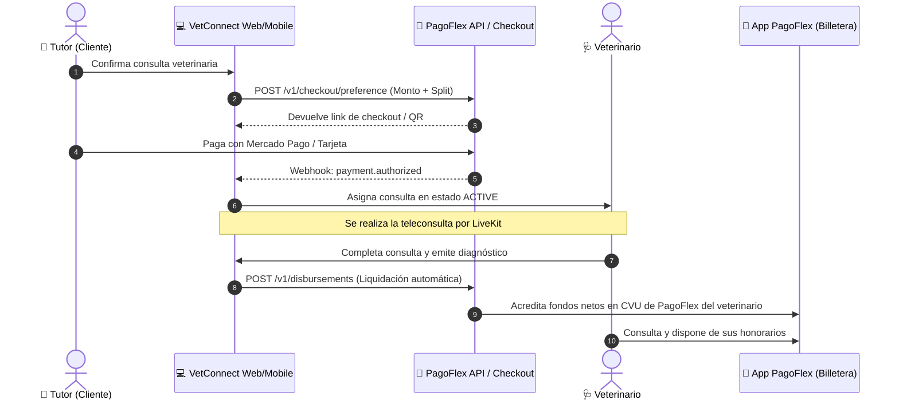

# 📑 02_PAGOFLEX_INTEGRATION_PLAN_B — Integración con PagoFlex (Plan B / Alternativa Local)

> **Estado del Documento:**  
> **PLAN B / ALTERNATIVA BAJO REVISIÓN.** Esta integración refleja la propuesta de colaboración estratégica del CEO con la fintech argentina **PagoFlex** ([pagoflex.com.ar](https://pagoflex.com.ar/)).  
> Se mantiene en reserva y supeditada a aprobación formal. La definición base del sistema sigue siendo la **Arquitectura Marca Blanca Agnóstica** descrita en el Plan A.

---

## 1. Contexto y Visión de la Propuesta

La iniciativa contempla un esquema de sinergia entre productos del grupo:
* **Canal de Cobro para Veterinarios:** Los profesionales veterinarios deben crearse una cuenta en la aplicación móvil de **PagoFlex** (PSP regulado en Argentina), siendo esa billetera el único destino habilitado para la recepción de sus honorarios médicos.
* **Canal de Pago para Tutores:** Los clientes/tutores de mascotas abonan la consulta médica a través de un checkout interoperable que acepta **Mercado Pago**, tarjetas de crédito/débito o cualquier billetera virtual compatible con transferencias inmediatas / QR interoperable.

---

## 2. Flujo de Integración Técnica (`PagoFlexAdapter`)

Para evitar que esta dependencia rompa la neutralidad del software para otros clientes, se diseñaría como un plugin o implementación concreta de la interfaz `IPaymentGateway`:

---

## 3. Matriz de Riesgos y Trade-offs Críticos

Antes de confirmar la adopción de este esquema, el equipo técnico y de producto identificó los siguientes puntos de impacto:

### 3.1 Pérdida de la Condición de Marca Blanca Pura
* **Impacto:** Si la plataforma exige por defecto la aplicación PagoFlex, el software **no puede ser exportado ni vendido como producto empaquetado** a clínicas o consorcios de otros países (ej. Uruguay, México, España o Chile), dado que PagoFlex opera bajo el marco regulatorio del Banco Central de la República Argentina (BCRA) con cuentas CVU en pesos argentinos.
* **Mitigación:** Mantener `PagoFlexAdapter` como un módulo opcional que solo se activa para la instancia argentina operada directamente por la empresa, preservando el núcleo del código 100% agnóstico.

### 3.2 Fricción de Onboarding Profesional
* **Impacto:** Para poder atender guardias telemédicas, el veterinario no solo debe certificar su matrícula profesional (SENASA / Colegio de Veterinarios), sino que se le obliga a descargar una aplicación financiera adicional de terceros y completar un proceso de validación biométrica de identidad (KYC bancario).
* **Mitigación:** Si el CEO aprueba este plan, se debe diseñar una pantalla de bienvenida que explique el beneficio de cobro inmediato de honorarios a través de PagoFlex.

### 3.3 Régimen Legal, Impositivo y Operativo
* **Exportación de Software vs. Operación de Plataforma:**
  * Si la empresa factura licencias de software al exterior, tributa como exportadora de servicios de tecnología (régimen general de exportación de software).
  * Si la empresa intermedia en el cobro de consultas médicas en Argentina recibiendo el dinero del tutor y dispersándolo a los veterinarios con retención de comisión, pasa a operar un **Marketplace de Servicios Profesionales**. Esto acarrea obligaciones como agente de información ante ARCA/AFIP, retenciones de Impuesto a las Ganancias, IVA sobre comisiones e Ingresos Brutos (Convenio Multilateral).

---

## 4. Conclusión y Recomendación Arquitectónica

1. **El Core del Repositorio es Marca Blanca (Plan A):** Toda la base de código, la documentación raíz y los contratos de datos deben continuar diseñándose bajo el estándar neutral de Marca Blanca exportable.
2. **Encapsulamiento del Plan B:** Si la dirección del proyecto da la orden ejecutiva de proceder con PagoFlex, se programará exclusivamente la clase `backend/src/modules/payments/adapters/PagoFlexAdapter.ts`, sin alterar las entidades de consulta ni obligar a otros entornos a acoplarse a esta pasarela.
